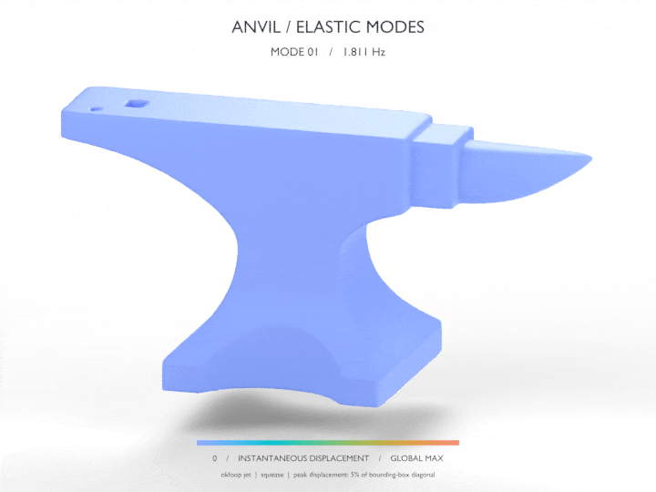

# warpack

Sparse eigenvalue problems computed in **NVIDIA Warp**, with an optional **cuDSS** inverse backend. FP64 arithmetic, device-resident projected eigensolves and residuals, and reusable CUDA graphs. NumPy, SciPy, CuPy, and Spectra are references in the tests and benchmarks; they do not perform eigensolver computation inside the library.

This is a first implementation, not an API-compatible drop-in replacement for Spectra or ARPACK. It covers their main eigenproblem families, with performance work focused on **large sparse problems**. The 283,857-DOF anvil comparison below reports timings and accuracy against ARPACK, Spectra, and CuPy.

[Download the animated teaser and editable Blender scene](https://github.com/alecjacobson/warpack/releases/tag/v0.1.3)



Anvil adapted from [“Blacksmith's Anvil”](https://sketchfab.com/3d-models/blacksmiths-anvil-4b11b76fe069496ebd8ccd98f7d37ade) by [m4rcu5j4ck50n](https://sketchfab.com/m4rcu5j4ck50n), licensed under [CC BY 4.0](https://creativecommons.org/licenses/by/4.0/). Tetrahedral mesh and vibration visualization adaptations are described in [Acknowledgments](ACKNOWLEDGMENTS.md).

## Supported problems

| Problem | API | Notes |
|---|---|---|
| Real symmetric | `KrylovSchur` | Thick restart, two-pass reorthogonalization, LM/LA/SA/SM/BE selection |
| Symmetric block inverse iteration | `SymmetricEigensolver` | CholeskyQR2 and Rayleigh–Ritz; supply an iteration operator that amplifies the requested spectrum |
| Symmetric generalized `A x = λ B x` | `GeneralizedKrylovSchur`, `GeneralizedEigensolver` | SPD mass, including non-diagonal sparse B; B-orthonormal eigenvectors; restarted Krylov or block inverse iteration; interior targeting |
| Complex Hermitian | `HermitianEigensolver` | Standard problems via realified restarted Krylov; complex basis and breakdown recovery; replayable complex starting vector; broader Spectra convergence gaps remain |
| Real or complex nonsymmetric | `GeneralEigensolver` | Restarted complex Arnoldi, device Hessenberg reduction and shifted QR; LM/SM/LR/SR/LI/SI selection |
| Real or complex shift-invert | `ShiftInvertEigensolver` | Nearest eigenpairs using cuDSS or pure-Warp GMRES; `hermitian=True` selects Hermitian Krylov for real shifts and supports complex starts |
| Buckling / Cayley | `BucklingEigensolver`, `CayleyEigensolver`, `GeneralizedKrylovSchur` | Block or restarted Krylov transforms; original-problem residuals |
| Partial rectangular SVD | `PartialSVD` | Largest nonzero real singular triplets through an augmented symmetric operator |
| Pure-Warp SPD inverse | `CGInverse` | Preallocated Warp CG, optional upstream preconditioning, device convergence checks |
| Known invariant-space exclusion | `MassOrthogonalComplementInverse` | Correct primal/dual projections for SPD mass, optional device normalization; caller supplies the invariant space |
| Symmetric equality-constrained modes | `ConstrainedKrylovSchur` | SPD physical mass, independent equality constraints, finite modes via KKT shift-invert; multiplier and constraint residuals; [skinning example and comparisons](benchmarks/applications/SKINNING.md) |
| Numerical nullspace evidence | `NumericalNullspaceDiagnostics` | Captured physical/metric checks, weak-positive and capacity flags; completeness remains unverified |

`SparseOperator` accepts compact scalar FP64 CSR or 3×3 FP64 BSR matrices from `warp.sparse`. Complex inputs use `HermitianCSR` or `ComplexCSR`, with values stored as `wp.vec2d(real, imaginary)`; `SparseOperator` accepts real matrices only. The general and Hermitian paths are currently reference implementations; their performance has not been tuned to the level of the real symmetric path. The SVD path is validated for leading nonzero singular triplets; recovery of nullspace bases is not currently supported.

The installed `warpack` package contains the numerical solvers, inverse backends, spectral transforms, constraint operations, and diagnostics. Application matrix construction lives in [`examples/problems/`](examples/problems/README.md), shared by the showcase, benchmarks, and tests. This includes tetrahedral elasticity, mesh loading, rigid-motion bases, and skinning weight/rig matrices. These helpers require a source checkout and are not installed as library APIs.

## Install

```bash
python -m pip install -e '.[test]'
# Optional sparse direct inverse:
python -m pip install -e '.[cudss]'
# Reference GPU/CPU benchmarks:
python -m pip install -e '.[benchmark]'
```

The latest full validation used Python 3.10, Warp 1.18.0+cu12 with the pinned FSAI overlay below, CUDA driver 570.158.01, cuDSS 0.8.0.10, CuPy 14.2.0, and an NVIDIA L40. The package requires Warp >=1.15, but stock Warp 1.15 has only the limited compatibility check described below; installing the extras above does not install the FSAI overlay. Conditional graphs require CUDA driver support for CUDA 12.4 or later. Complex data and solver workspaces use double precision. The best FSAI result below uses FP32 preconditioner factors with FP64 products and CG; its pinned Warp PR environment is documented in [Validation and benchmarking](#validation-and-benchmarking).

## Symmetric solve and graph replay

```python
import warp as wp
from warpack import SparseOperator, KrylovSchur

# A is a compact, square, FP64 warp.sparse.BsrMatrix already on the GPU.
solver = KrylovSchur(SparseOperator(A), k=20, ncv=48, which="LM", tol=1e-10)
graph = solver.capture(max_iterations=100)
wp.capture_launch(graph)

# Device arrays: no implicit readback.
values = solver.eigenvalues       # (k,)
vectors = solver.eigenvectors     # (k, n), eigenvectors are ROWS
errors = solver.residuals
converged = solver.converged      # number of converged requested eigenpairs
iterations = solver.iterations
```

For symmetric solves, the reported residual is `||A x - λ x||₂ / max(1, |λ|)`, with unit-norm vectors. A normalized tolerance does not guarantee the same absolute residual bound when eigenvalues are large. `status == 0` means no internal factorization failure; it does **not** mean all eigenpairs converged. Check `converged == k` and the residuals. A fixed iteration budget can expire without convergence. `SM` targets are generally better addressed with shift-invert than an untransformed Krylov iteration.

`capture()` compiles and warms kernels, allocates setup state, and constructs a reusable graph. Ordinary symmetric and general iterations use a device-controlled conditional loop. cuDSS requires a **fixed outer graph**. `CGInverse` also defaults to fixed outer capture for compatibility; `CGInverse(..., adaptive_capture=True)` enables nested device-controlled loops when upstream CG preallocates its loop storage (tested on the pinned Warp 1.18 environment). Stock Warp 1.15 rejects this opt-in because it allocates storage inside each solve. See the [adaptive-CG report](benchmarks/experimental/ADAPTIVE_CG.md). The compatible capture policy is selected automatically; `capture(iterations, adaptive=False)` explicitly selects a fixed graph. Fixed outer loops still perform all numerical work on device. There are no hidden host eigensolves or residual readbacks.

Matrix **values** can change between replays with stable array addresses. Changing a sparse topology requires a new operator/solver setup. An inverse's factors must also be updated or recreated when matrix values change. A solver instance owns mutable workspaces and is not thread-safe. Destroy graphs before closing their inverse backend; never replay a graph after its factors have been released.

## Inverse and generalized problems

```python
from warpack import CuDSSInverse, GeneralizedKrylovSchur

# Kshift is A - sigma*B, assembled on device before factor setup.
sigma = 7.3
inverse = CuDSSInverse(
    Kshift, width=1, mtype="general", matching=True, refinement_steps=1,
)
solver = GeneralizedKrylovSchur(
    SparseOperator(A), SparseOperator(B), inverse,
    k=20, ncv=48, target=sigma, tol=1e-10,
)
graph = solver.capture(40, adaptive=False)
wp.capture_launch(graph)
```

`GeneralizedKrylovSchur` uses `which="LM"` in shift-invert mode to select modes nearest `target`; with SPD A and a zero target, these are the lowest modes. For an interior shift, pass the matching `target=sigma`; sorting by smallest algebraic value is not equivalent to sorting by distance to an interior shift. The generalized residual uses `||Ax-λBx||₂ / max(1, ||Ax||₂+|λ| ||Bx||₂)`. Inner iterative inverses need tighter tolerances than the outer eigensolve. Verify the residual in the **original** problem after any spectral transformation; `EigenpairEvaluation` provides this for real standard problems, and `ShiftInvertEigensolver` does so automatically for complex shift-invert.

For sparse indefinite factors, `mtype="general", matching=True` enables cuDSS column matching and scaling during setup. Matching defaults to zero correction; the example adds one fixed correction for tighter inverse accuracy. Without matching, symmetric-indefinite/general factors retain one correction by default, and SPD retains zero. Set `refinement_steps` explicitly to choose the budget. Each correction forms `b - A*x` in Warp, applies the existing cuDSS factors, and updates `x` in Warp. No host convergence check occurs. Check original-problem residuals for the chosen settings; the [factorization report](benchmarks/upstream/MATCHING.md) records accuracy, speed, and rejected alternatives.

`BucklingEigensolver(..., method="krylov")` uses a one-RHS inverse and stiffness-orthogonal Krylov iteration. `GeneralizedKrylovSchur(..., mode="cayley", target=sigma)` ranks Cayley-transformed magnitudes with an SPD mass. Both return original eigenpairs; their selection differs from ordinary nearest-shift targeting. See the [generalized-transform validation and comparisons](benchmarks/upstream/TRANSFORMS.md).

cuDSS analysis and first factorization are setup operations outside graph capture. cuDSS may use host work during that setup. A retained Warp workspace allocator avoids `cudaMalloc` inside captured cuDSS solves. Its setup also finalizes Warp's exact BSR nonzero count before scalar CSR expansion. Captured cuDSS solves retain small vendor HtoD metadata copies. The [CUDA API and graph audit](benchmarks/applications/CUDSS_GRAPH.md) finds no explicit synchronization calls or residual readbacks during warm replay, but measures nonzero host enqueue cost; the strict zero-host-transfer gap remains [#29](https://github.com/alecjacobson/warpack/issues/29).

`CGInverse` provides a pure-Warp SPD inverse using upstream CG and either an upstream preconditioner name or a prebuilt Warp preconditioner. For free-body elasticity, the example helper `examples.problems.elasticity.rigid_body_basis` constructs six rigid motions on device. `OrthogonalComplementOperator` handles Euclidean-orthonormal rows in mass-normalized coordinates. For a generalized pencil with consistent mass, `MassOrthogonalComplementInverse` applies the correct primal/dual mass projections, with optional device basis normalization. See the [API and validation](benchmarks/applications/MASS_PROJECTION.md). See the [anvil settings](#timing-and-accuracy) for the best recorded FSAI configuration.

`CGInverse(..., atol=0.0)` requests relative stopping for small right-hand sides, subject to upstream Warp's dtype safety floor. The default `atol=None` preserves Warp's use of `tol` as both the relative and absolute tolerance. This distinction matters when using a loose inner tolerance for residual preconditioning; always check the original eigenproblem residual.

For sequences of related systems, the block solvers `SymmetricEigensolver` and `GeneralizedEigensolver` accept `initial_vectors=starts`: a device FP64 array with independent rows and shape `(r, n)`, where `1 <= r <= ncv`. Remaining rows are seeded randomly. Captured initialization reads the current contents of `starts`, so callers can copy previous modes into it before replay. Check `status`, original residuals, and requested-spectrum coverage; a good starting subspace does not certify completeness. The inverse/factors must match the current matrix. This is block inverse iteration, not LOBPCG; Krylov solvers retain their separate single-vector interface. See [related-FEM validation and remaining block-method work](benchmarks/applications/BLOCK_STARTS.md).

## Anvil showcase

[`examples/problems/elasticity.py`](examples/problems/elasticity.py) assembles the stable Neo-Hookean rest Hessian and lumped mass in Warp; its `RestElasticity` helper supports graph-captured value updates. The example then supplies these matrices to the library's eigensolver.

The current README GIF uses the supplied [`anvil for export-ftetwild.mesh`](anvil%20for%20export-ftetwild.mesh), read directly from disk: **94,619 vertices, 508,903 tetrahedra, and 283,857 degrees of freedom**. No mesher is invoked. The longest rest extent is normalized to one metre; the illustrative material uses `E = 100,000 Pa`, `ν = 0.3`, and `ρ = 1,000 kg/m³`, with a free body, stable Neo-Hookean rest Hessian, and lumped mass. Six rigid modes are checked and omitted, then the first 20 elastic modes are shown in order.

Each mode's maximum displacement is **5% of the rest bounding-box diagonal**, checked over **all vertices**, including the interior. The normalized diagonal is 1.18974049 m, so every peak displacement is 0.05948702 m. The smooth, continuous gptoolbox `okloop(256,-4*pi/3,-pi/2)` palette has **no isoline stripes**. Color follows instantaneous displacement with one fixed scale for the entire sequence. Each mode eases from rest to peak and back with `squease`; the camera stays fixed against a white studio background. The GIF has 660 frames at 20 fps, lasting 33 seconds.

The maximum original-problem normalized residual is **2.62e-9**, and the mass-orthogonality error is **1.91e-14**. Frequencies span **1.811–9.166 Hz** under the illustrative material parameters. These are exaggerated linear mode shapes. See the [numerical report](results/anvil_modes.json), [scale and style metadata](results/anvil_teaser.json), and [evaluated scene validation](results/anvil_teaser_validation.json).

Reproduce with Blender 4.5 and [gifski](https://gif.ski/):

```bash
python -m examples.dragon_modes --mesh "anvil for export-ftetwild.mesh" \
  --out results/anvil_modes.npz
blender -b --python examples/render_modes.py -- \
  --input results/anvil_modes.npz --output results/anvil_base.blend \
  --name Anvil --up-axis Y --yaw-degrees 90
blender -b --python examples/render_teaser.py -- \
  --base results/anvil_base.blend --input results/anvil_modes.npz \
  --output results/anvil_teaser.blend --name Anvil --up-axis Y --yaw-degrees 90 \
  --amplitude-bbd 0.05 --frames build/anvil_frames --render
blender -b results/anvil_teaser.blend --python-exit-code 1 --python examples/validate_teaser.py
gifski --fps 20 --quality 85 --width 720 --repeat 0 \
  --output results/anvil_teaser.gif build/anvil_frames/frame_*.png
```

The mesh name, orientation, and displacement cap are rendering options; the eigensolver and Hessian are unchanged. The [`v0.1.3` release](https://github.com/alecjacobson/warpack/releases/tag/v0.1.3) includes the input mesh, modes, editable Blender scene, GIF, and validation metadata.

### Timing and accuracy

Best recorded accepted configurations for the same **283,857-DOF anvil**, including six rigid and 20 elastic modes. The CPU rows were rechecked with MKL PARDISO on 2026-10-15; the GPU rows retain the earlier measurements. This is not a fresh matched rerun of every backend, and newer experimental block results are reported separately below. Solve times are medians of three synchronized trials after warmup, on an **NVIDIA L40** or **Intel Xeon Platinum 8362 (four BLAS threads)**. Each trial restores its starting vector. Setup is a single recorded factorization or preconditioner construction, separate from the median solve time; solve excludes mesh I/O/assembly, transfers, JIT/warmup/graph capture, and final original-problem validation.

| Method | Setup (s) | Solve (s) | Max original residual, all 26 |
|---|---:|---:|---:|
| SciPy ARPACK + MKL PARDISO | 9.5567 | 16.5791 | 4.011e-9 |
| Spectra + MKL PARDISO | 13.4716 | 9.9369 | 2.737e-8 |
| CuPy eigsh + shared cuDSS | 2.1534 | 0.4587 | 2.852e-9 |
| Warp + cuDSS | 2.2063 | 0.4669 | 2.610e-9 |
| Warp + FSAI-preconditioned CG (64-entry rows) | 5.0477 | 9.6082 | 3.036e-9 |

All five pass the common original-problem residual cutoff of **1e-7**, orthogonality cutoff of **1e-8**, and elastic mode-shape checks. Residuals are `||Av−λv||₂ / max(1,|λ|)` for unit-norm vectors and the original mass-normalized operator. Elastic frequencies agree with the reference to within **6.56e-14 relative error**. CPU and Warp rows report the worst residual across their three timed trials.

The direct-inverse rows solve with **`A + I`** and `ncv=64`, where `A = M^(-1/2) K M^(-1/2)` is the mass-normalized stiffness. This is `sigma = -1` in the `A - sigma*I` shift-invert convention. CuPy's row explicitly wraps shared cuDSS factors; cuDSS is supplied by this benchmark. Both CPU rows use MKL PARDISO SPD Cholesky through Eigen, METIS ordering, a four-thread limit, and internal refinement disabled. ARPACK runs through SciPy; Spectra remains native C++ without Python matvec callbacks. These are separate runs of the same factor configuration: their setup differences and solve-time variation should not be interpreted as intrinsic eigensolver overhead. The [CPU factorization audit](benchmarks/ANVIL_FACTORIZATION.md) preserves the former SuperLU/Eigen timings, explains their large fill-in and numerical factorization costs, and records the rejected PARDISO refinement profile. Factor setup is reusable for the same matrix and shift; changed values generally require numerical refactorization. CPU/GPU inverse implementations differ.

The production pure-Warp setting in this table solves with **`A + 10,000 I`** (`sigma = -10,000`), `ncv=120`, one outer cycle, and inner CG tolerance **1e-12** with a 10,000-iteration limit. Six rigid motions are constructed analytically in Warp and projected out; the 20 elastic modes are computed numerically, and all 26 modes are validated. Rigid-basis setup costs an additional **0.0155 s**, excluded from the setup column. FSAI uses `max_row_size=64`, `max_step_size=3`, `apply_lanes=8`, and FP32 factor storage with FP64 products and CG. These settings are tuned for this anvil. Reference eigensolutions are used only for validation.

A newer [experimental block solve](benchmarks/experimental/ADAPTIVE_CG.md), outside the public API, reduces Anvil replay to **4.4616 s** using batched upstream CG with FP32 inner work, FP64 outer iteration and adaptive stopping. All 20 elastic modes pass the unchanged accuracy gates; worst original residual across three trials is **1.801e-8**, and the returned-pair residual stays below the requested **1e-8**. Fresh production baselines are **9.5782 s** for CG and **0.4671 s** for cuDSS. The experiment records **1.1297 s total preconditioner/workspace setup** and **1.0185 s capture**, with compiled kernels cached; these boundaries differ from the factor-only table above. It uses FSAI32, ten inner steps, width 24 and 36–38 adaptive outer steps. The iterative path still has a substantial gap to cuDSS.

FSAI comes from the unmodified [Warp PR #16](https://github.com/alecjacobson/warp/pull/16), pinned to `04427b997fe7ff07bc6ed1dde5ca9813496c6b55`. Its construction synchronizes outside capture; preconditioner application and the complete eigensolve are graph capturable. The recorded CG graph has no host-copy or host-callback nodes; median host enqueue is **1.311 ms**.

Sources: [current ARPACK + PARDISO](results/anvil_pardiso_noir_confirmed.json), [current Spectra + PARDISO](results/anvil_pardiso_spectra_confirmed.json), [original CPU and retained CuPy comparison](results/anvil_benchmarks.json), [latest Warp + cuDSS recheck](results/anvil_cudss_recheck.json), and [best CG settings and per-replay accuracy](results/anvil_cg_optimized.json). Earlier configurations and unsuccessful trials are in the [historical experiments](historical/README.md).

## Validation and benchmarking

The [application coverage suite](benchmarks/applications/README.md) adds physics/geometry fixtures for nine API classes, independent spectrum and original-equation checks, and accuracy-gated ARPACK/Spectra/CuPy comparisons. [Coverage issues and priorities](https://github.com/alecjacobson/warpack/issues/18) track the remaining gaps. `GeneralizedKrylovSchur` adds mass-orthogonal restarted Krylov iteration for SPD-mass pencils; it supports nearest-shift solves and regular mass-inverse LM/LA/SA selection. Its required inverse has one RHS.

The [latest full local validation](results/performance_followup/adaptive-validation.json), recorded on **2026-10-19**, has **500 passing tests** in the pinned FSAI environment, with passing lint, formatting and wheel-build checks. This is separate from the upstream conformance runs: subsequent focused reruns update selected families, not the entire upstream suite. [Warp residual correction of cuDSS inverses](benchmarks/upstream/REFINEMENT.md) fixes all 24 real CuPy SM eigenvector failures and the local damped-chain regression. That report records the full upstream rerun, strict-count regressions and correction overhead separately. The [complete Hermitian follow-up](benchmarks/upstream/HERMITIAN_LARGE.md) passes all 30 Spectra Hermitian fixtures through 1,000 complex unknowns, with unchanged original tolerances and full counts, and corrects basis-width reporting. The [matched-factor follow-up](benchmarks/upstream/MATCHING.md) adds sparse-indefinite regressions and recovers the interior-mode timing gap, with explicit accuracy profiles and preserved failed experiments. The [generalized-transform follow-up](benchmarks/upstream/TRANSFORMS.md) passes all 21 supported generalized Spectra cases, with independent spectrum/subspace regressions and native comparisons. The [Hodge coverage report](benchmarks/applications/HODGE.md) adds independent topology/nullspace checks, weak-component and disconnected fixtures, and separately labeled native CuPy eigsh and generalized LOBPCG comparisons. Its [CG follow-up](benchmarks/applications/HODGE_CG.md) validates faster explicit Krylov profiles, with rejected short budgets and strict-count distinctions retained. The [elastic ROM coverage](benchmarks/applications/FEM.md) adds clamped/free and disconnected tetrahedral bodies, material contrast, consistent mass and complete repeated-mode checks, including upstream block-Jacobi/FSAI comparisons. The [interior-band coverage](benchmarks/applications/INTERIOR.md) checks coupled FEM pencils, repeated nearest-mode sets and large frequency-band comparisons. The [inner-CG accuracy follow-up](benchmarks/applications/CG_ACCURACY.md) records profiles that also meet strict outer counts at large sizes and 20/40 modes. The [device nullspace diagnostic](benchmarks/applications/NULLSPACE.md) distinguishes returned near-zero modes, weak positives, invalid data and capacity limits without claiming a certified Betti count. The [metric-QR recovery](benchmarks/applications/WEAK_BLOCK.md) fixes non-finite generalized block modes on extreme weak components, with full requested-space checks and measured recovery overhead. The broader [pinned CuPy and Spectra conformance runs](benchmarks/upstream/RESULTS.md) expose additional numerical failures, unsupported interfaces, and timeouts; the local suite is not full upstream conformance. The [Krylov restart regression report](benchmarks/upstream/MULTIPLICITY.md) records the multiplicity fixes and adaptive-performance tradeoffs. The [large POD comparison](benchmarks/applications/POD.md) adds tall/wide and repeated singular subspaces, vibrating-string snapshots, native ARPACK/Spectra/CuPy comparisons, and pure-Warp long-row product improvements. The fifteen [constrained skinning tests](benchmarks/applications/SKINNING.md) also pass on stock Warp 1.15. [Cached multiplier recovery](benchmarks/applications/SKINNING_PERFORMANCE.md) removes redundant KKT solves, bringing the large skinning replay to 288 ms alongside adapted CuPy+cuDSS at 288 ms. Earlier Anvil compatibility checks passed six tests, with four upstream block-Jacobi cases skipped. See the [original Anvil validation and source provenance](results/anvil_cg_validation.json) for that compatibility check.

The [experimental block eigensolver report](benchmarks/experimental/README.md) adds captured LOBPCG-style iteration, changed-pencil replay, and direct-FSAI/truncated-CG Anvil accuracy checks. It remains outside the public API. Its original timings were contended. The [batched-CG follow-up](benchmarks/experimental/BATCHED_CG.md) adds uncontended timings, independent mixed-precision regression coverage and explicit workspace setup accounting. The [adaptive follow-up](benchmarks/experimental/ADAPTIVE_CG.md) adds nested upstream CG, stock-version rejection tests and a 79.08 ms large Hodge solve; the production table above retains its recorded configurations. The new `CGInverse.atol` regressions also pass on stock Warp 1.15.

The [normal-product POD experiment](benchmarks/experimental/NORMAL_POD.md) computes 20 triplets of a 100,000×48 clustered snapshot matrix in **15.41 ms**, versus **74.78 ms** for CuPy and **198.80 ms** for the production augmented Warp formulation. It remains outside the public API because normal equations square conditioning; the report preserves rank limits, failed experiments and matched original-equation checks. Production `PartialSVD` now refreshes its cached transpose on device when matrix values change between replays, fixing [#63](https://github.com/alecjacobson/warpack/issues/63).

The [Hermitian breakdown follow-up](benchmarks/upstream/HERMITIAN.md) fixes the seven reported complex identity/low-rank CuPy failures and adds changed-matrix replay and complex subspace checks. The [complex-start follow-up](benchmarks/upstream/HERMITIAN_STARTS.md) adds replayable device starting vectors, invalid-input status and 15 newly enabled CuPy cases. The [Hermitian shift-invert follow-up](benchmarks/upstream/HERMITIAN_SHIFT.md) fixes inaccurate sparse complex inverse solves, passes all 20 small Spectra Hermitian cases, and enables the remaining 48 CuPy SM starting-vector cases. The [general SM follow-up](benchmarks/upstream/GENERAL_SM.md) resolves the five listed nonsymmetric failures with matched factors and an explicit 200-cycle budget for compact cases; it does not claim success at the old 30-cycle budget. These focused correctness runs do not update timings or establish full upstream conformance.

The [Davidson-fixture and SVD follow-up](benchmarks/upstream/DAVIDSON_SVD.md) passes all eight cases with explicit wider Krylov spaces at unchanged tolerances: `ncv=40` for the symmetric fixtures and `ncv=20` for SVD. It adds paired SVD equations, physical convergence counts, and independent spectrum/subspace checks; 69 focused tests pass in the pinned environment and 46 on stock Warp 1.15. Production defaults and timing tables remain unchanged, and failed narrow-space controls are preserved.

The tests cover rectangular SVD, buckling/Cayley transforms, FP64 fractional shifts, real symmetric and nonsymmetric spectra, complex Hermitian and general spectra, repeated/zero eigenvalues, both spectrum ends, interior real/complex shifts, non-diagonal mass, device convergence limits, graph replay with changed matrix values, FEM energy derivatives, rigid modes, and graph-captured FEM assembly. They also check the incremental projected matrix against `Q A Qᵀ`, captured breakdown recovery, small projected eigenproblems, orthogonal-complement projection, and pure-Warp graphs for host nodes/transfers. These are representative Spectra-style tests, not a complete port of every upstream test.

```bash
OPENBLAS_NUM_THREADS=4 python -m pytest -q
python -m pip install ruff
ruff check warpack tests benchmarks examples

git clone https://github.com/yixuan/spectra.git build/spectra
# Pin the revision used for the published comparison:
git -C build/spectra checkout db1d5cc3279752ca7ea3e33da44ba2a85e4e4a95
g++ -O3 -DNDEBUG -I/usr/include/eigen3 -Ibuild/spectra/include \
  benchmarks/spectra.cpp -o build/spectra_bench
OPENBLAS_NUM_THREADS=4 OMP_NUM_THREADS=4 python benchmarks/compare.py
```

<details>
<summary>Pinned environment and commands for the current anvil comparison</summary>

The recorded GPU runs use the official **Warp 1.18.0+cu12 native runtime** for CUDA driver 570.158.01. The original SuperLU/Eigen/CuPy comparison used upstream linear-solver revision `5a0c33d17d847d0be07ae1003263b572aae0729a`; its exact environment is retained in the [baseline notes](historical/anvil-baseline.md). The recorded Anvil Warp rows and their original 111-test validation used three unmodified FSAI PR modules overlaid on that runtime. The latest 500-test validation uses the same pinned environment. The current CPU PARDISO rows use MKL 2020.4.304 and Eigen 3.4.0; their build and run commands are in the [factorization audit](benchmarks/ANVIL_FACTORIZATION.md#reproduction). Install the Warp overlay without changing the default Warp installation:

```bash
python -m pip install --no-deps --target build/warp-fsai \
  'https://github.com/NVIDIA/warp/releases/download/v1.18.0/warp_lang-1.18.0%2Bcu12-py3-none-manylinux_2_28_x86_64.whl'
for f in warp/_src/optim/linear.py warp/_src/optim/fsai.py warp/optim/linear.py; do
  curl --fail --location \
    "https://raw.githubusercontent.com/alecjacobson/warp/04427b997fe7ff07bc6ed1dde5ca9813496c6b55/$f" \
    --output "build/warp-fsai/$f"
done
PYTHONPATH="$PWD/build/warp-fsai:$PWD" OPENBLAS_NUM_THREADS=4 python -m pytest -q

# Original Eigen LDLT/SuperLU CPU references and retained direct GPU comparison.
# Requires the pinned Spectra checkout above and Eigen headers.
g++ -O3 -DNDEBUG -shared -fPIC -I/usr/include/eigen3 -Ibuild/spectra/include \
  benchmarks/spectra_native.cpp -o build/spectra_native.so
PYTHONPATH="$PWD/build/warp-fsai:$PWD" OPENBLAS_NUM_THREADS=4 OMP_NUM_THREADS=4 \
  python -m benchmarks.anvil --part direct

# Creates a cuDSS validation reference if one is not cached in build/.
PYTHONPATH="$PWD/build/warp-fsai:$PWD" OPENBLAS_NUM_THREADS=4 OMP_NUM_THREADS=4 \
  python -m benchmarks.cg_experiments --mode eigen --shifts 10000 \
  --preconditioners fsai64f --ncv 120 --tol 1e-12 \
  --project-rigid --repeats 3 --profile --out results/anvil_cg_optimized.json
PYTHONPATH="$PWD/build/warp-fsai:$PWD" OPENBLAS_NUM_THREADS=4 OMP_NUM_THREADS=4 \
  python -m benchmarks.cg_experiments --mode eigen --shifts 1 \
  --preconditioners cudss --ncv 64 --repeats 3 --out results/anvil_cudss_recheck.json
```

</details>

[Historical experiments](historical/README.md) preserve the older release tables, dragon showcases and constitutive audits, synchronization investigations, and CG/warm-start tuning, including failed configurations and their reproduction commands.
